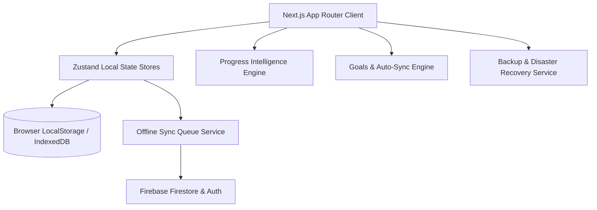

# Architecture Specification — One Percent

One Percent is a production-grade, offline-first Fitness Operating System built with Next.js 15 (App Router), React 19, TypeScript, TailwindCSS, Zustand, and Firebase Firestore/Auth.

---

## 1. High-Level System Architecture

---

## 2. Directory & Layer Responsibilities

- `app/(app)/`: App Router pages (`/dashboard`, `/training`, `/analytics`, `/body`, `/goals`).
- `features/`: Domain-driven feature modules (`auth`, `training`, `goals`, `body`, `analytics`, `performance`, `achievements`). Each feature folder encapsulates its own components, services, and Zustand stores.
- `lib/`: Core application foundation.
  - `lib/services/`: System infrastructure services (`sync-queue.service.ts`, `backup.service.ts`).
  - `lib/constants/`: Versioning, route registry, cache keys, query keys (`VERSION.ts`, `ROUTES.ts`, `QUERY_KEYS.ts`).
  - `lib/types/`: Strict TypeScript models with schema versioning metadata.
  - `lib/utils/`: Shared utilities (`date.ts`, `migration.utils.ts`, `image.utils.ts`).

---

## 3. Core Architecture Patterns

### Repository Pattern
State is managed locally first via Zustand stores, exposing optimistic update methods to components while silently enqueuing remote write operations to `syncQueueService`.

### Offline-First Philosophy
Components render instantly from local cache/stores without blocking on network requests. Synchronization occurs asynchronously in the background.

### Schema Versioning & Migrations
All persisted stores declare `CURRENT_SCHEMA_VERSION = 1` and validate state structures via `migrateStoreState()` on hydration.
